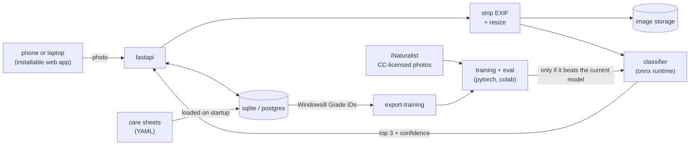

```
      .-'~~~~'-.
    .'  o    o  '.
   /  o    o   o  \         __   __
  '-.,__________,.-'       (  \ /  )
        |    |              \_ Y _/
        |    |                 |
  ______|____|_________________|________
```

# Sporadic

*A field guide for the plants and fungi living in your apartment.*

<sub>Named for spores, and for how often I used to water things.</sub>

[](#roadmap)
[](#results)
[](#whos-building-this)

Take a photo of a houseplant (or the weird mushroom that just showed up in its pot), and **sporadic** tells you what it probably is, how sure it is, and what it needs from you. Every ID goes into a living inventory of your apartment, organized by room and windowsill, with a care sheet and a pet-safety warning attached.

It's iNaturalist, brought indoors.

> **Status:** early, and actively being built. The roadmap at the bottom is the honest version of what's done.

## The problem

iNaturalist is wonderful for wild things. It isn't built for your windowsill. Anything marked captive or cultivated is "Casual" grade, which keeps it out of research-grade data and out of the queue most identifiers work through. So the organisms people actually live with fall through the gap: the pothos from the grocery store, the succulent a roommate left behind, the bright yellow mushroom that appeared in a pot overnight.

Not knowing the name matters more than it sounds. Most houseplants are sold with a tag that says "tropical foliage" or nothing at all, and without the species you can't look up how much light it wants, how dry it should get between waterings, or whether it'll hurt your cat if she chews on it.

sporadic closes that loop: **photo → ID → care.** It's open source, and it publishes exactly how its model is evaluated, including where it's bad.

## What it does

*Screenshots once there's something worth screenshotting.*

### Snap, identify, confirm

Take a photo straight from your phone's browser, no app store required. The model returns its top three guesses with a confidence for each. You pick the right one, correct it, or leave it as **Needs ID** for someone else to weigh in on.

When the model isn't confident, it says so. "Not sure, but it might be one of these" beats a confident wrong answer, so the cutoff is tuned on held-out data instead of picked by feel.

```
observation #0142 · bedroom shelf, east window
──────────────────────────────────────────────────────────────
  1. Epipremnum aureum          golden pothos             71%
  2. Philodendron hederaceum    heartleaf philodendron    24%
  3. Scindapsus pictus          satin pothos               3%

  lookalikes  1 and 2 are easy to mix up. check a leaf stalk:
              grooved along the top     → pothos
              round all the way around  → philodendron

  pets        toxic to cats and dogs (ASPCA)
  status      needs ID · model v0.3
```

### Lookalike checks

Some houseplants get mixed up constantly, and no amount of training data fully fixes that from a single photo. So when the top guesses are a known lookalike pair, the app shows the one feature that settles it and asks you to go look. The model narrows it down. You make the call.

### Your apartment as a field guide

Confirmed observations live in your collection, organized by room and spot ("bedroom, south window"). iNaturalist asks where on Earth you saw something. sporadic asks which windowsill. Each plant keeps a photo timeline, so you can tell whether that fiddle leaf fig is growing or just slowly giving up.

There's a one-tap watering log too. Reminders say "go check," not "go water," because watering on a fixed schedule is how you drown a snake plant.

### Care sheets and pet safety

Every species gets a care sheet, a YAML file in `data/care/` that's loaded into the database on startup. The ID results, lookalike checks, toxicity banners, and watering nudges all read from these, so fixing one number fixes it everywhere.

```yaml
# data/care/epipremnum-aureum.yaml
name: Golden pothos
species: Epipremnum aureum
kind: plant
difficulty: beginner      # survives most of what a college student can do to it

light: bright indirect, tolerates low
water: when the top 1-2 inches of soil are dry
humidity: average is fine
temp_f: [65, 85]

toxicity:
  cats: toxic
  dogs: toxic
  why: insoluble calcium oxalate crystals
  source: ASPCA

lookalikes:
  - species: Philodendron hederaceum
    check: >
      Look at a leaf stalk. Pothos stalks have a groove along the top,
      philodendron stalks are round. New philodendron leaves also come
      out of a thin sheath that dries up and turns brown.

notes: >
  Yellowing lower leaves most often mean too much water, not too little.
```

Toxicity shows up as a banner on the observation, not buried three taps deep.

### Community IDs

Anyone can add an ID to a public observation. Once at least two people have weighed in and more than two-thirds agree on a species, it reaches **Windowsill Grade** (modeled on iNaturalist's Research Grade). Every Windowsill Grade observation is also a newly labeled photo of a real plant in a real apartment, which is exactly the data the model is short on.

### Mystery mushrooms

The most common indoor fungus question isn't about growing mushrooms. It's "there's a mushroom in my plant, is that bad?" Usually it's *Leucocoprinus birnbaumii*, a bright yellow mushroom that hitches a ride in potting soil. It's harmless to the plant, it's poisonous if eaten, and pulling the caps off doesn't get rid of it, because the real organism lives in the soil.

sporadic recognizes the handful of fungi (and fungus lookalikes) that turn up indoors and tells you what each one means for the plant, and for any pets or kids nearby.

| What you see | Usually | Bad for the plant? |
|---|---|---|
| Bright yellow mushroom in the pot | *Leucocoprinus birnbaumii* | No. Keep pets and kids away from it. |
| Tiny cups with "eggs" inside | bird's nest fungi | No |
| White fuzz on top of the soil | saprophytic mold | Not directly, but the soil is staying too wet |
| A slimy blob that moves (slowly) | slime mold, which isn't actually a fungus | No |
| White powder on the leaves | powdery mildew | Yes. Isolate it and improve airflow. |

> [!WARNING]
> **sporadic will never tell you a mushroom is safe to eat.** Image classifiers get lookalikes wrong, and with mushrooms a wrong answer can put someone in the hospital. Fungal IDs here are about "is this hurting my plant" and "should I keep the cat away from it," not dinner. Edibility isn't a field in the database, on purpose.

### Grow journal *(later)*

For people who grow mushrooms on purpose, a grow becomes a journal: stages and timelines pulled from the care sheet (culture, grain, bulk, fruiting, harvest), a photo timeline, notes, and harvest weights per flush. Eventually the same pipeline that identifies plants gets trained to flag contamination, like the blue-green of Trichoderma, once there are enough labeled photos to do that honestly.

## The machine learning part

### Internet photos aren't apartment photos

Most plant photos online were taken in a greenhouse, a garden center, a jungle, or a carefully styled living room. Real apartment photos are dim, cluttered, lit by a yellow desk lamp, and have half the plant out of frame. A model can score great on internet photos and still fall apart on a bookshelf.

So the rule is: **train on whatever I can legally get, test only on real apartments.**

### Data

- **Training photos** come from iNaturalist through its [public API](https://api.inaturalist.org/v1/docs/), filtered to Creative Commons licenses, including both wild research-grade observations and cultivated ones. Every image's source, author, and license is recorded in `ml/data/manifest.csv`, and the images themselves stay out of git. My own photos (and friends', with permission) go in too.
- **The test set** is photos taken with phones, in real apartments, by real people. None of them are ever used for training.
- **Splits are by plant, not by photo.** Ten photos of the same pothos are basically one photo. If some land in training and some in test, the model gets graded on a plant it has already memorized.
- **The class list starts small:** about 40 of the most common houseplants. Some classes are genus-level on purpose. Grocery store orchids are mostly hybrids that can't be told apart from a photo, and the app shouldn't pretend otherwise.

Taxonomy follows iNaturalist's so the labels match the training data, which is how the snake plant ended up filed under *Dracaena*.

<details>
<summary><b>The starting class list</b></summary>

**Aroids:** *Epipremnum aureum* (golden pothos), *Philodendron hederaceum* (heartleaf philodendron), *Scindapsus pictus* (satin pothos), *Monstera deliciosa*, *Monstera adansonii* (Swiss cheese vine), *Rhaphidophora tetrasperma* ("mini monstera," which is not a monstera), *Zamioculcas zamiifolia* (ZZ plant), *Syngonium podophyllum* (arrowhead plant), *Anthurium andraeanum* (flamingo flower), *Spathiphyllum* (peace lily, genus), *Aglaonema* (Chinese evergreen, genus), *Dieffenbachia* (dumb cane, genus), *Alocasia* (elephant ear, genus)

**Succulents and cacti:** *Dracaena trifasciata* (snake plant), *Aloe vera*, *Crassula ovata* (jade plant), *Haworthiopsis attenuata* (zebra haworthia), *Sedum morganianum* (burro's tail), *Curio rowleyanus* (string of pearls), *Beaucarnea recurvata* (ponytail palm, not a palm), *Echeveria* (genus), *Schlumbergera* (holiday cactus, genus)

**Ferns and palms:** *Nephrolepis exaltata* (Boston fern), *Asplenium nidus* (bird's nest fern), *Chamaedorea elegans* (parlor palm), *Dypsis lutescens* (areca palm)

**Everything else:** *Chlorophytum comosum* (spider plant), *Ficus lyrata* (fiddle leaf fig), *Ficus elastica* (rubber plant), *Dracaena fragrans* (corn plant), *Pachira aquatica* (money tree), *Hoya carnosa* (wax plant), *Peperomia obtusifolia* (baby rubber plant), *Pilea peperomioides* (Chinese money plant), *Tradescantia zebrina* (inch plant), *Maranta leuconeura* (prayer plant), *Fittonia albivenis* (nerve plant), *Begonia maculata* (polka dot begonia), *Goeppertia* (calathea, genus), *Phalaenopsis* (moth orchid, genus), *Tillandsia* (air plants, genus), *Ocimum basilicum* (basil, see roadmap)

**Indoor fungi (v0.3):** *Leucocoprinus birnbaumii* (yellow houseplant mushroom), Nidulariaceae (bird's nest fungi, family), Erysiphaceae (powdery mildew, family), Myxogastria (slime molds, not fungi), white soil mold (catch-all)

</details>

### Three approaches, one leaderboard

Start with the cheapest thing that could work, and only add complexity when the numbers say to.

| Approach | Training cost | Why try it |
|---|---|---|
| Zero-shot [BioCLIP](https://huggingface.co/imageomics/bioclip) | none | A vision-language model trained across the tree of life. It only needs class names, so it's the baseline on day one. |
| Linear probe on frozen embeddings (BioCLIP or DINOv2) | minutes, on a laptop | Often gets surprisingly close to full fine-tuning for a fraction of the compute |
| Fine-tuned EfficientNet-B0 | an hour or two on a free Colab GPU | Small, fast on a CPU, and exports cleanly to ONNX |

Whichever does best on the apartment test set ships.

### Results

*No numbers until they're real. These get filled in from `docs/evaluation.md`.*

| Model | Top-1 | Top-3 | Calibration error (ECE) | CPU latency |
|---|---|---|---|---|
| BioCLIP zero-shot | - | - | - | - |
| Linear probe | - | - | - | - |
| EfficientNet-B0, fine-tuned | - | - | - | - |

Evaluation also reports per-class accuracy and a confusion matrix, because a good average can hide a class it never gets right.

### Knowing when it doesn't know

- **Calibration.** Temperature scaling on a validation set, so that when it says 70%, it's right about 70% of the time.
- **Abstaining.** Below a tuned threshold, the answer becomes "not sure" and the observation goes to Needs ID instead of getting a wrong label.
- **Out-of-scope photos.** The test set includes things that aren't any of the classes (other plants, pets, a few fake plants, because someone will try) to measure how often the model confidently names something that isn't there.

### Getting better from corrections

Every observation stores the model version, its top three guesses, and the final ID. `make export-training` pulls Windowsill Grade observations into a new training batch. A retrained model only ships if it beats the current one on the same frozen test set, and every version gets a short model card in `ml/models/` covering its data, its numbers, and its known weak spots.

## How it fits together



**Stack:** Python (FastAPI, SQLAlchemy, PyTorch, timm, open_clip, ONNX Runtime), React + Vite as an installable web app, SQLite in development and Postgres once deployed, Docker Compose.

## Why it's built this way

**Small and honest beats big and confident.** Forty classes done well is more useful than four thousand done badly, and "not sure" is a feature, not a failure.

**Inference on the server, for now.** One model to update, and any phone works. Since the model is ONNX, moving it into the browser later with onnxruntime-web is a small step instead of a rewrite.

**A web app, not a native one.** Phone browsers can open the camera directly (`<input type="file" accept="image/*" capture="environment">` is the whole trick), so there's nothing to install and no app review to get through.

**EXIF gets stripped on upload.** Phone photos carry GPS coordinates, and a picture of your bedroom shelf shouldn't come with your address. The room name is the only location sporadic stores.

**Care sheets are YAML in git.** Fixes come in as pull requests, every change has a history, and one file per species is easy to review.

**SQLAlchemy from the start.** SQLite is perfect on a laptop, Postgres is better once other people are using it, and with an ORM the switch is a config change.

**No edibility field.** Not now, not later.

## Running it

The repo is split up like this:

```
sporadic/
├── server/          FastAPI app: accounts, observations, IDs, inference
├── web/             the React app, installable on a phone
├── ml/
│   ├── data/        download scripts + license manifest (images are gitignored)
│   ├── notebooks/   training and evaluation, runnable in Colab
│   └── models/      exported ONNX models + a model card for each version
├── data/care/       one YAML care sheet per species
└── docs/            evaluation results, dataset notes, design decisions
```

To run the app:

```bash
git clone https://github.com/YOUR-USERNAME/sporadic.git
cd sporadic
cp .env.example .env     # secret key, database URL, image storage path
make model               # downloads the latest released model into ml/models/
docker compose up
```

The web app comes up at `localhost:5173` and the API docs at `localhost:8000/docs` (thanks, FastAPI). `make seed` fills it with demo observations so there's something to click on.

No hardware required. The first version of this project needed a Raspberry Pi. This one needs a phone.

To train and evaluate a model:

```bash
cd ml
pip install -r requirements.txt
python fetch_inat.py --classes classes.yaml --per-class 300    # CC-licensed photos only
python train.py --approach linear-probe --backbone bioclip
python evaluate.py --test-set data/apartment_test/
python export.py                                               # writes the ONNX model + model card
```

Or open `ml/notebooks/train.ipynb` in Colab and use the free GPU.

## Roadmap

**v0.1: it can tell a pothos from a philodendron**

- [ ] Class list and care sheets for the first ~40 houseplants
- [ ] iNaturalist download script with a license manifest
- [ ] Apartment test set: 300+ photos from at least 5 different apartments
- [ ] BioCLIP zero-shot baseline and linear probe, written up in `docs/evaluation.md`
- [ ] Upload a photo, get top 3 predictions back in the web app

**v0.2: it's an app**

- [ ] Accounts, collections by room, and photo timelines
- [ ] Lookalike checks and pet toxicity banners
- [ ] Calibrated "not sure" threshold
- [ ] One-tap watering log ("go check," not "go water")
- [ ] Deployed somewhere friends can actually use it

**v0.3: it's a community**

- [ ] Community IDs and Windowsill Grade
- [ ] Indoor fungi classes: plant-pot mushrooms, soil mold, slime molds, powdery mildew
- [ ] Training export and retraining pipeline, with a model card for every version

**Someday, probably**

- [ ] Mushroom grow journal, plus contamination flags once there are enough labeled photos
- [ ] Pest and problem detection: spider mites, mealybugs, fungus gnats, root rot symptoms
- [ ] On-device inference with onnxruntime-web
- [ ] Bring back the sensors: ESP32 + SHT31 humidity nodes for a fruiting chamber
- [ ] Keep a basil plant alive for an entire semester

## Who's building this

Hi, I'm [Your Name], a software engineering student at [School]. I'm looking for a **software engineering or development co-op or internship** starting [term], so if you're hiring, I'd really like to hear from you.

I've done software engineering work with three companies so far:

<!-- one line each. a number (users, latency, hours saved) beats an adjective -->
- **[Company]** · [Role] · [dates]: [what you built or shipped]
- **[Company]** · [Role] · [dates]: [what you built or shipped]
- **[Company]** · [Role] · [dates]: [what you built or shipped]

This project is my excuse to work through the whole life of an ML product: collecting and licensing data, setting honest baselines, evaluating on the data that actually matters, serving a model behind an API, and improving it from real users' corrections. Plus a web app that people other than me actually use.

Fun fact: I wrote my first program at 9 and had my first website live at 10. Keeping things alive that don't plug into a wall came later, which is more or less why this repo exists.

[email](mailto:you@example.com) · [linkedin](https://www.linkedin.com/in/your-handle) · [github](https://github.com/YOUR-USERNAME)

## Credits and fine print

- Training photos are by iNaturalist contributors, under the Creative Commons license listed for each image in `ml/data/manifest.csv`. sporadic isn't affiliated with iNaturalist.
- BioCLIP is from the Imageomics Institute.
- Toxicity info comes from the ASPCA's toxic and non-toxic plant lists and isn't veterinary advice. If a pet ate something, call your vet or the ASPCA Animal Poison Control Center at (888) 426-4435 (a consultation fee may apply).

---

<sub>Code is MIT licensed. Some training photos are CC BY-NC, so released model weights are for non-commercial use. Take whatever's useful, especially the care sheets.</sub>
